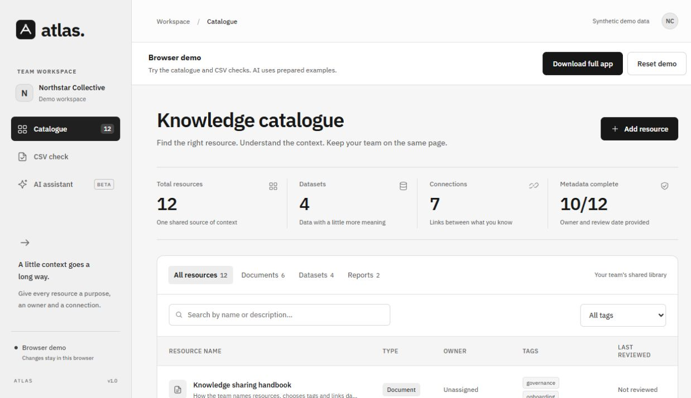
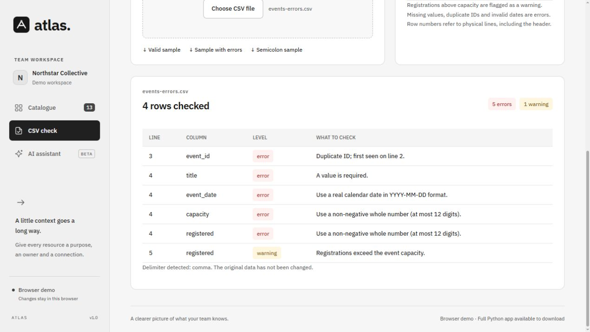
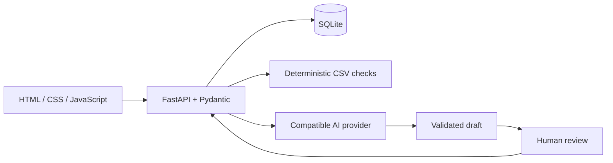
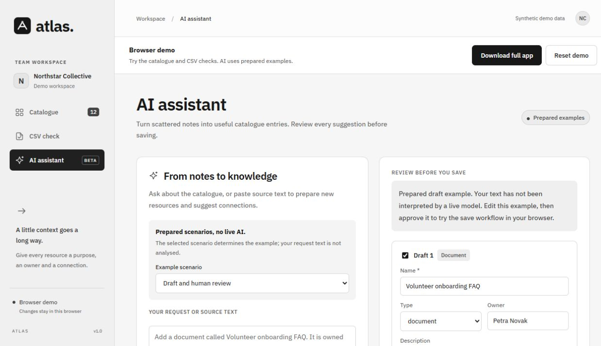
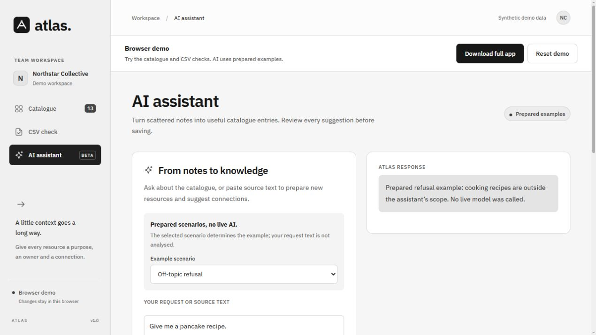

# Atlas

**Team knowledge, connected.** A local-first catalogue for documents, datasets and reports, with deterministic CSV quality checks and AI-assisted, human-reviewed record creation.

[Open Atlas in your browser](https://atlas-catalog-vejl.pages.dev) · [Download the full local app](https://atlas-catalog-vejl.pages.dev/downloads/atlas-source.zip)

Atlas brings resource descriptions, information quality checks and knowledge sharing into one workspace. The fictional **Northstar Collective** organises community events; all supplied records and people are synthetic.



## What you can do

- Search and filter resources, edit their metadata and follow directed connections.
- Check event CSVs for missing values, duplicate IDs, invalid dates and inconsistent counts.
- Ask an AI assistant to turn source text into editable catalogue drafts and suggested relationships.
- Review and explicitly approve every AI-assisted write. Model output cannot execute SQL.
- Inspect a deliberately basic scope guardrail: off-topic requests, such as recipes, should be declined.

## Two ways to run Atlas

The **browser demo** runs entirely in the visitor's browser: catalogue editing, resource connections, CSV checks and explicitly labelled prepared AI scenarios. Changes are saved in that browser's local storage and can be reset. No provider key or shared server database is used. Dictation remains a browser service and may send audio to the browser's provider.

The **full local app** is a source ZIP with Python, FastAPI and SQLite. Download it from the demo's **Download full app** button and read `START-HERE.txt`. It supports real AI proposals with your own API key. Python 3.14 is required; no Python runtime or private credentials are bundled.

To build the static version locally, run `python scripts/build_demo.py`. Output is `web/atlas-demo/dist`; serve that directory over HTTP. The build copies only synthetic seed data, public assets and a filtered source download. It does not deploy the site or create a GitHub repository. The intended web host is Cloudflare Pages; see [deployment notes](docs/deployment.md).

## Quick start

**Requirements:** Python 3.14 (the tested version), an internet connection for the first dependency installation, and a browser. An AI key is optional for the catalogue and CSV checker.

On Windows, extract the ZIP or clone the repository, then double-click **`start-atlas.cmd`**. It creates an isolated `.venv`, installs dependencies on the first run, and starts the local server. Open [Atlas locally](http://127.0.0.1:8000). Keep the terminal open; press Ctrl+C to stop.

Alternatively, from the project directory:

```powershell
py -3 -m venv .venv
.\.venv\Scripts\python.exe -m pip install -r requirements.txt
.\.venv\Scripts\python.exe run.py
```

On macOS/Linux:

```sh
python3 -m venv .venv
.venv/bin/python -m pip install -r requirements.txt
.venv/bin/python run.py
```

Both variants serve the app at `127.0.0.1:8000`. The server serves the UI and API together. There is no Node build, frontend package installation or external font dependency.

### Local data

On first startup, Atlas creates `data/atlas.sqlite3` with 12 resources and 7 directed connections. Edits persist after restarting. You can override its location with `ATLAS_DATABASE` in your environment or `.env`. Local files are excluded from Git and the source ZIP.

## AI setup

1. Follow the [CERIT-SC access instructions](https://docs.cerit-sc.cz/en/docs/ai-as-a-service/chat-ai). MU students have a documented university registration route. Your actual access and available models must be verified with your account.
2. In the provider's chat settings, open **Account → API keys** and create your own key, following the [API guide](https://docs.cerit-sc.cz/en/docs/ai-as-a-service/ai-api).
3. Copy `.env.example` to `.env` in this project directory. Fill in the key locally:

```dotenv
AI_BASE_URL=https://llm.ai.e-infra.cz/v1
AI_API_KEY=your-own-key
AI_MODEL=mini
```

`mini` is a starting alias from the provider documentation, **not a verified model for your account**. Use a model or supported alias available to you. No paid plan is activated by Atlas.

4. Check access and list models, without printing your key:

```powershell
.\.venv\Scripts\python.exe scripts\check_ai.py
```

5. Set `AI_MODEL` as needed, restart Atlas, then open **AI assistant → Use an example request → Ask Atlas**. Edit the draft and choose **Save selected drafts**.

To run three small real-model checks (proposal, recipe refusal and embedded instructions):

```powershell
.\.venv\Scripts\python.exe scripts\check_ai.py --live
```

This calls your configured provider, may consume its quota, and writes a local report to `data/live-check.json`. It does not create catalogue records. A successful model-list check alone does not prove inference works.

### Use your own compatible provider

Set your own **base URL ending in `/v1` (or the equivalent provider API prefix)**, API key and model identifier. Atlas appends `/chat/completions` and uses a standard messages request. The provider must accept this format and return text under `choices[0].message.content`. A key from an unrelated API is not automatically compatible. Native Gemini API support is not included.

The request text and brief context for up to 60 catalogue resources are sent to the configured provider. API keys stay on the backend. Network calls use a 90-second timeout; provider errors are shown without the key or raw provider response.

### AI boundaries

The server's system prompt limits the assistant to catalogue records, metadata, connections and event CSV checks. Unrelated requests should receive a short refusal. Uploaded/source text is treated as untrusted content. This is a **basic behavioural guardrail**, not a guarantee against prompt injection.

The backend independently validates types, dates, URLs and target resource IDs. Incomplete optional facts remain empty. Proposal generation performs no database writes. Confirmation revalidates edited records and writes the batch in a transaction. A confirmation receipt prevents duplicate writes on retry.

No AI output is rendered as HTML. Catalogue strings are escaped in the UI. The app binds to loopback, checks browser origins and allowed host names, and has no multi-user authentication. Run it locally; public hosting requires a separate deployment and access design.

## Dictation and field guidance

In **AI assistant**, the five initial chips show Name and Type (required), followed by Owner, Description and Reviewed. The three-dot button reveals URL, Tags and Connections. Unknown optional metadata can stay empty.

Click **Dictate** to start browser speech recognition; click **Stop** to pause, then **Dictate** to continue. Choose Slovak, Czech or English before starting. Partial results appear directly in the text field as the browser supplies them and can be revised by its speech service. The field follows the latest words; pausing keeps the visible transcript. Review it before clicking **Ask Atlas**. Dictation never submits the request or saves resources automatically. The microphone changes to a compact wave while listening; movement follows speech detection and incoming transcripts, not an audio-volume measurement. It settles during silence and respects reduced-motion preferences.

**Clear** empties the request. **Undo** or **Ctrl+Z** restores it and steps through earlier edits; **Ctrl+Shift+Z** or **Ctrl+Y** redoes them. Typing, example loading and each dictation session participate in this local history. Interim transcript revisions are grouped into their session. Clear and undo wait until dictation is paused. History stays in memory and resets when leaving the AI view or reloading.

This uses the browser's [Web Speech API](https://webaudio.github.io/web-speech-api/), not the configured catalogue AI endpoint. Support, available languages and streaming speed depend on the browser and recognition service. Audio may be sent to the browser provider. No audio is stored by Atlas. The first use requests microphone access; unsupported browsers and denied permissions have a typing fallback. Live microphone transcription was confirmed by the user in Chrome; controller edge cases use simulated recognition events.

Atlas uses its own file button, selected-file label and inline validation messages. The operating system's file picker and browser microphone permission prompt remain native. Unknown browser paths return a styled HTML 404 with a catalogue link; unknown API paths keep JSON errors. Unknown hash views also show a recovery view.

### Slovak, Czech and review dates

The model receives explicit field meanings and examples for Slovak, Czech, mixed-language dictation, missing diacritics and spoken dates. The prompt asks it to preserve supplied names and text and to answer in the request’s language; this guidance is not a guarantee for every response. For example: `Vytvor dokument s názvom Ranný meeting. Review nastav na 12. decembra 2026.` fills `reviewed_on` with `2026-12-12`. **Reviewed is the resource review date.** An event date is retained in the description; an ambiguous date requires clarification. Missing years are not guessed. This remains model interpretation, with backend type/date validation and human review.

Run `python scripts/check_metadata.py` to evaluate eight synthetic language/date/scope cases against your own configured model. It sends no local catalogue and performs no database writes. The latest run passed 8/8; this is evidence for these examples, not a guarantee for arbitrary dictated text.

## Event CSV format

```csv
event_id,title,event_date,capacity,registered
EVT-001,Introduction to SQL,2026-11-14,30,24
```

| Column | Rule |
|---|---|
| `event_id` | Required; unique within this file |
| `title` | Required text |
| `event_date` | Real calendar date, exactly `YYYY-MM-DD` |
| `capacity` | Non-negative whole number, up to 12 digits |
| `registered` | Non-negative whole number, up to 12 digits |

All five columns and their values are required. Extra columns are permitted but not validated. UTF-8/BOM, comma and semicolon delimiters are supported. The limit is 2 MiB (2,097,152 bytes). Blank rows are skipped. Reported line numbers refer to physical lines, including the header; for a quoted multiline record, its ending line is reported.

`registered > capacity` is a warning. Invalid fields and duplicate IDs are errors. Duplicate headers, invalid encoding and malformed CSV produce a clear upload error. Files are processed locally and are neither sent to AI nor saved. AI creates catalogue metadata, **not rows in the uploaded CSV**.

Samples in `samples/`:

- `events-valid.csv`: 3 rows, 0 errors, 0 warnings.
- `events-errors.csv`: 4 rows, 5 errors, 1 warning.
- `events-semicolon.csv`: 2 rows, 0 errors, 0 warnings.
- `ai-source.txt`: a synthetic request for a new document.



## Architecture



The important code is small and separated by responsibility:

| Area | Where to look |
|---|---|
| HTTP endpoints and confirmation | `atlas/main.py` |
| Typed inputs and model output | `atlas/models.py` |
| Schema, SQL and transactions | `atlas/schema.sql`, `atlas/db.py` |
| CSV validation | `atlas/csv_check.py` |
| System prompt and provider call | `atlas/ai.py` |
| UI | `static/index.html`, `static/styles.css`, `static/app.js` |

See [the data model](docs/architecture.md) and [the demo script](docs/demo.md).

### HTTP interfaces

| Method / route | Behaviour |
|---|---|
| `GET /api/status` | Counts and whether a key is configured; no secret values |
| `GET /api/resources?q=&type=&tag=` | Search and filter |
| `GET /api/resources/{id}` | Resource detail and incoming/outgoing connections |
| `POST /api/resources` | Create a validated resource |
| `PUT /api/resources/{id}` | Replace its editable metadata |
| `POST /api/resources/{id}/relations` | Add a directed connection |
| `GET /api/tags` | Tags currently attached to resources |
| `POST /api/csv/check` | Multipart `file` → counts and line-level issues |
| `POST /api/ai/proposals` | `{text}` → `proposal`, `answer` or `refusal` |
| `POST /api/ai/confirm` | `{request_id, records}` → saved resource IDs |

The machine-readable contract is [OpenAPI JSON](http://127.0.0.1:8000/openapi.json) when running locally. Interactive documentation that depends on CDN scripts is disabled to keep the UI self-contained.

## Tests and reproducibility

```powershell
.\.venv\Scripts\python.exe -m pip install -r requirements-dev.txt
.\.venv\Scripts\python.exe -m pytest -q
```

Tests cover persistence, filters, URL and date validation, directed links, foreign keys, hostile search strings, upload limits, exact CSV error locations, model errors, scope refusals, proposal/confirmation separation, rollback and retry idempotency. AI tests use an injected `httpx.MockTransport`; no paid API calls or API credentials are needed in CI.

The GitHub Actions workflow is configured for Python 3.14/Linux. `requirements-lock.txt` records the complete tested environment, including test dependencies. To reproduce that environment, install it instead of `requirements-dev.txt`.

Speech controller tests run separately with Node.js (no npm packages):

```powershell
node --test tests/*.test.mjs
```

The local checks pass **36 Python tests and 19 frontend tests**. GitHub Actions runs both suites on source pushes and pull requests. Simulated speech tests cover incremental text, pause/resume, length limits, permission refusal, unsupported browsers and navigation cleanup. They do not replace a real microphone test.

The three real-model checks passed with the CERIT-SC `mini` alias during local verification. The browser flow also produced an editable draft, saved an approved record with its connection, and declined a recipe request. Other accounts and model versions should run `scripts/check_ai.py --live` themselves. Mocked refusal tests verify application handling; they do not prove that a live model refuses every off-topic request. See [verification notes](docs/verification.md).





## Troubleshooting

- **AI setup needed:** fill `.env`, check the model identifier, and restart the server. “Key configured” means present, not tested.
- **401/403:** verify the key and account's model permissions. **429:** wait for quota/service availability. **Timeout:** retry a smaller request later.
- **Invalid AI draft:** the response did not match the required schema or referenced an unknown resource. Nothing was saved. Refine the input and retry.
- **Port 8000 in use:** stop the other Atlas terminal or run `python -m uvicorn atlas.main:app --host 127.0.0.1 --port 8001`, then open port 8001.
- **Python launcher missing on Windows:** install Python from its official distribution, or use `python` instead of `py -3` in the manual steps.
- **Dependency installation fails:** check network access and your Python version. The tested interpreter is Python 3.14.
- **Changed `.env` but nothing happened:** stop and restart the server; it reads configuration at startup.
- **CSV exported from a spreadsheet fails:** save it as UTF-8 with the documented column names and ISO dates.

## Packaging and publication

Run `python scripts/package.py` to create `outputs/atlas-source.zip` inside the project folder. Packaging uses an allowlist and excludes credentials, local data and caches. The ZIP contains source code, not an embedded Python installation.

### Local monochrome design iteration

The current UI uses a grey/white/black palette, self-hosted IBM Plex Sans, stronger typography and custom black hand / I-beam cursors. Each cursor is solid black without an outline or shadow; there is no page glow, tracking overlay or cursor JavaScript. Fine-pointer devices use the custom cursors; touch devices keep native behaviour. Theme rules are in `static/monochrome.css`, and cursor assets are in `static/cursors/`. The font is included with its SIL Open Font License. Existing AI verification screenshots may show the previous colour palette; live-model results remain unchanged by this visual iteration.

## Project status and authorship

Developed with AI assistance. Atlas provides catalogue metadata, relational modelling, deterministic data validation and reviewed AI-assisted operations. The full Python application is designed for local, single-user use; the browser demo is a separate, self-contained mode.

MIT licensed. Service access and model licences remain subject to the selected provider's terms.
