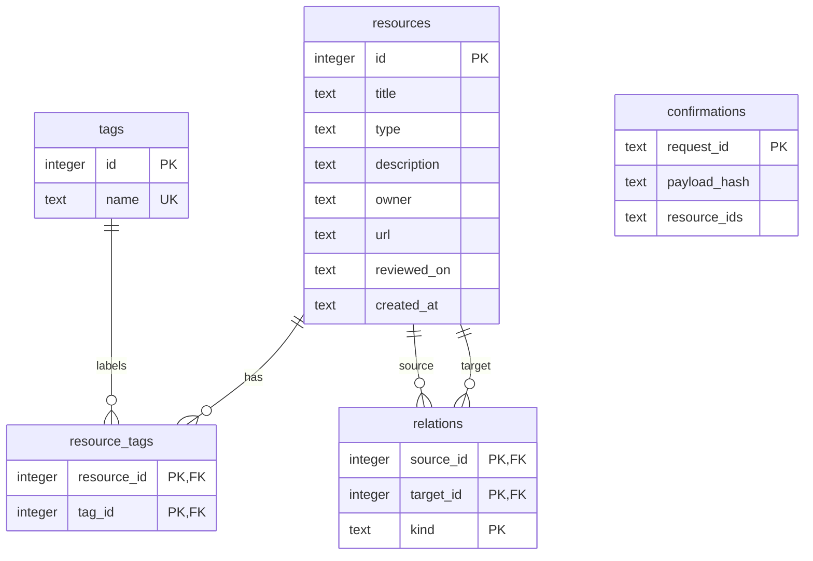

# Architecture and data model

Atlas uses a single FastAPI process. Its static frontend calls relative `/api/` endpoints. SQLite is local and all uploaded CSV checks are deterministic. Only the AI assistant contacts the configured model provider.

## Why these tables?

One resource can have many tags and one tag can describe many resources. `resource_tags` represents that many-to-many relationship without comma-separated database fields. Tag names are normalised to lowercase at the API boundary.

A relationship has a source, target and kind. “A report **derived from** a dataset” has a direction. The UI displays outgoing and incoming links, but does not silently reverse their meaning. The composite primary key prevents duplicate relationships. A CHECK constraint prevents self-links.

The small `confirmations` table is an operational receipt. A stable request identifier plus a hash of the approved payload allows network retries to return the original resource IDs without inserting duplicates. It does not represent model-generated knowledge.

## Transactions and validation

`connect()` turns foreign keys on for every connection. Its context manager commits a successful operation and rolls it back if any exception escapes. `confirm_batch()` uses `BEGIN IMMEDIATE` so receipt lookup and inserts are serialized together. An invalid relationship in any approved record rolls back the entire batch.

Pydantic validates every manual write and edited AI draft. `http://` and `https://` are the only accepted source URL schemes. SQL values use placeholders. User text is escaped before insertion into HTML; the model's output is never evaluated as code.

## AI is a proposal service

The call contains a server-owned scope prompt, a JSON output schema, the source request and brief metadata for at most 60 existing resources. There is no vector database or autonomous tool loop. The catalogue context is deliberately bounded to keep the application understandable; it is not comprehensive retrieval for a large organisation.

The response kind is `proposal`, `answer` or `refusal`. Only a proposal may contain records. Suggested relationship targets must exist in the supplied context. Exact case-insensitive title matches are displayed as possible duplicates for human review, not automatically merged.

The confirmation endpoint independently validates the edited payload. It can also accept manually assembled valid drafts: model provenance is not treated as authority to write. The local user is the operator. Multi-user permissions and public deployment are future work.

The system prompt is a basic scope guardrail. Reliability needs empirical evaluation for the selected model. Database invariants remain enforced even if the model responds incorrectly.
